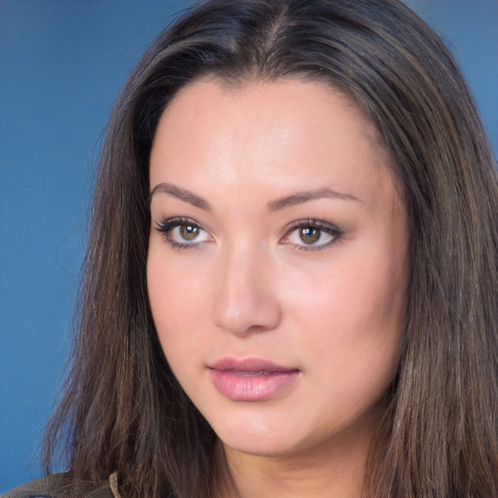

# 生成 Prompt — Bold Brutalist（张扬野性）

> 复制本文件全文，发给任意「能写前端的 agent」。它应输出**单个自包含 `index.html`**，效果与本目录 `index.html` 基本一致。除一条 Google Fonts `<link>` 与一张本地 `portrait.jpg`（hero 头像）外，不引用任何外部资源。

---

You are a senior frontend designer-developer. Generate a single self-contained `index.html` in the **Bold Brutalist** direction for the person below. All CSS in one `<style>`, all JS inline. No build step, no frameworks. The only external resources are one Google Fonts `<link>` and one local image (`portrait.jpg`).

## The person (brief)

- **Name**: Alex Mercer
- **Role**: Graphic designer & art director
- **Audience**: brands, founders and label heads deciding whether to hire for identity / art-direction work
- **Primary goal**: get them to view the work and start a project
- **Thesis**: *"Most brands whisper. I make the ones that decide to be heard."*
- **Tone**: playful, graphic, confident, a little provocative
- **Location**: London · Worldwide
- **Proof points (concrete — use verbatim)**:
  - 10 years in brand & art direction; 40+ brand identities shipped
  - Ex-Art Director at a London studio — now independent (studio of one)
  - 2024 D&AD Wood Pencil — festival identity
  - Featured 2× in *It's Nice That* & *Brand New*
  - Clients across music, fashion, and indie tech
- **Contact**: email `studio@alexmercer.work` · Instagram `@alexmercer` · Behance (full portfolio)
- **Brandmark**: "AM STUDIO" with a small pink square `dot`. Footer line: "© 2024 Alex Mercer — AM Studio" / "Most brands whisper. Mine don't."

## Module plan (in this order)

Sticky **top bar**: brandmark "● AM STUDIO" left; nav right — Work / Proof / Method / Words / Services / FAQ (hidden < 760px) / **Contact ↗** (always shown). Add a skip-link "Skip to work".

1. `hero` → **bold_statement**: eyebrow tags `Graphic Designer` (acid) · `Art Director` (blue) · `London · Worldwide` (white). Giant uppercase H1 that nearly bleeds off-edge: "Most brands / **whisper.** / I make the ones / that decide to be / **heard.**" — "whisper." gets an acid strike-through behind it, "heard." is blue. Beside/under it a rotated **portrait** photo (see Photo contract); the `u-fallback` is a pink rotated name-block "Alex Mercer". Lede: *"Identity & art direction with a loud point of view — **10 years**, **40+ brands** built across music, fashion and indie tech. If you want to be remembered, start here."* CTAs: `Start a project ↗` (blue) + `See the work` (ghost). Below the hero, a full-bleed **marquee** strip (ink bg, canvas text, acid diamond separators) auto-scrolling: D&AD Wood Pencil '24 · It's Nice That · Brand New · Music · Fashion · Indie Tech · Festival Identities · Type-Led Branding (duplicated for seamless loop). Marquee items: display font `clamp(15px,2.4vw,22px)` / 800 uppercase / letter-spacing .02em, vertical padding `13px 0`; the acid diamond is `11px×11px` rotated 45° with margin `0 clamp(20px,4vw,40px)`.
2. `selected_work` → **grid**: section head `01 / Selected Work` + meta "Identities & art direction · 2021—2024". Six bordered project tiles, hard offset shadows, tiles offset off-grid (staggered `margin-top`). Each tile = a flat **color block thumb** (`aspect-ratio:4/3`, glyph bottom-aligned with 16px padding) with a big uppercase glyph (2 letters) + a rotated square ornament, then name / brand / year-chip / discipline-chip / `↗`:
   - DB · **Decibel Festival** · Independent music festival · full identity · 2024 · Brand ID (acid)
   - VX · **Vellum & Co.** · Fashion label · art direction · 2023 · Art Direction (blue)
   - OR · **Orbit OS** · Indie tech · product & brand · 2023 · Identity (pink)
   - NS · **Noise Records** · Record label · sleeve & type system · 2022 · Type System (ink)
   - HM · **Halftone Mag** · Indie print mag · editorial direction · 2022 · Editorial (paper)
   - FW · **Fuzz & Wire** · Streetwear drop · campaign & logo · 2021 · Campaign (blue)
3. `metrics` → **big_numerals**: section head `02 / Receipts` + meta "Ten years in brand & art direction. The numbers, and where the work shows up." Four colored blocks (`min-height:172px`, numeral top / label bottom via space-between), giant numeral + label: **40+** Brand identities shipped (acid) · **10** Years in brand & art direction (blue) · **'24** D&AD Wood Pencil — festival identity (pink) · **2×** Featured: It's Nice That & Brand New (paper). Trailing `.label` line (`margin-top:clamp(18px,3vw,26px)`, muted, letter-spacing .1em): "Ex-Art Director · London studio — now independent."
4. `story` → **quote_led**: an ink card (pink offset shadow), kicker "03 — How I work", oversized uppercase blockquote: *"I don't do **quiet**. I find the one true thing a brand won't shut up about — then build a **system loud enough** to say it everywhere, on every surface, without flinching."* ("quiet" in acid, "system loud enough" in pink). Signed by an `AM` avatar + "**Alex Mercer** — graphic designer & art director, working with music, fashion & indie tech."
5. `beliefs` → **numbered**: section head `04 / House Rules` + meta "Six things I won't compromise on — the spine under every identity I ship." Six numbered cards (numeral color rotates blue/pink/ink): **01 Pick a fight** — "A brand that's for everyone is for no one. We choose what it stands against before we draw a thing." · **02 Type does the talking** — "Before logos, before color — the letterforms. Get the voice right and the rest falls into place." · **03 One system, every surface** — "Poster, app, hoodie, invoice. If the rules only work on the hero shot, they don't work." · **04 Contrast over comfort** — "Safe is forgettable. I'd rather push the dial too far and pull back than ship something beige." · **05 Ship it loud** — "Work that hides in a folder isn't finished. We build for the real world, in public." · **06 No mood-board mush** — "Decisions, not references. Every choice has a reason you can say out loud in one sentence."
6. `testimonials` → **cards**: section head `05 / Word On The Street` + meta "What founders and label heads say after the dust settles." Four quote cards (first acid, second blue, rest white), big quote mark + text + `XX` avatar + name/role:
   - "Alex didn't design us a logo, he gave us a backbone. We finally sound as loud as we actually are." — **Jules Tan**, Founder, Decibel Festival
   - "Fastest a designer has ever understood the room. The type system runs our whole label now — every sleeve, every drop." — **Rina Mokri**, A&R, Noise Records
   - "We came in scared of being "too much." He talked us out of it in ten minutes and our sell-through doubled." — **Dev Vellum**, Creative Director, Vellum & Co.
   - "Working with Alex is like turning the lights all the way up. Slightly terrifying, exactly what we needed." — **Priya Khan**, CEO, Orbit OS
7. `selected_quotes` → **large_type**: a pink full-width band, oversized uppercase: *"If they don't remember it **tomorrow**, we **failed** today."* ("tomorrow" blue; "failed" set in an ink/acid inline highlight).
8. `services` → **list**: section head `06 / What You Hire Me For` + meta "Three ways in. Scope is a conversation — these are the starting lines." A bordered list (3-col rows ≥760px: no. / title+desc / price pill): **01 Brand Identity** — "Naming through to a full system: logo, type, color, motion and a guidelines doc your team can actually use." — From £12k · **02 Art Direction** — "Campaign and editorial direction for a launch, a season or a release — I set the look and steer the shoot." — From £6k · **03 Identity Sprint** — "One loud week. We pin the positioning, the voice and a starter kit you can run with immediately." — £3.5k / week.
9. `credentials` → **pills**: section head `07 / Receipts, Part Two` + meta "Awards, features and the rooms I've stood in." Bordered pills (bg cycles acid/white/pink), each year + line: **'24** D&AD Wood Pencil — Brand Identity · **'24** It's Nice That — Graphic Design · **'23** Brand New — Reviewed & Approved · **'23** OFFF Barcelona — Speaker · **'22** Type Directors Club — Cert. of Excellence · **'14** BA (Hons) Graphic Design — Central Saint Martins.
10. `faq` → **accordion**: section head `08 / Before You Ask` + meta "The things every new client wants to know on day one." Native `<details>` rows with a `+`/`–` blue/pink sign box:
    - **How long does a brand take?** — "A full identity is typically 6–10 weeks. Need it yesterday? The Identity Sprint compresses the core decisions into one loud week."
    - **Will it be as loud as your portfolio?** — "Only as loud as your brand earns. I push hard, but the volume is calibrated to your audience — bold is a strategy, not a default setting."
    - **Do you work with small or new brands?** — "Absolutely — some of my favorite work is launch work. The Sprint exists exactly for teams who need a strong start without a big-studio retainer."
    - **Who actually does the work?** — "Me. I'm an independent studio of one and bring in trusted collaborators (motion, web, print) only when a project needs them — you always deal with me directly."
    - **What do you need from us to start?** — "A short call, an honest answer to "what do you want to be known for," and a green light. I'll handle the rest of the brief."
11. `contact` → **cta_band**: a huge acid block, giant uppercase headline "Let's make / n**oi**se" ("oi" pink). Row: a black mail bar `studio@alexmercer.work ↗` (acid text, white/`--surface` offset shadow) + two social tiles (`min-height:84px`) — **Instagram** `@alexmercer` (hover pink) · **Behance** "Full portfolio" (hover blue). These three snap on hover by a smaller `translate(3px,3px)` (the mail bar's shadow collapses to `3px 3px 0`), not the full `--off` used elsewhere.

Footer (border-top, canvas): "© 2024 Alex Mercer — AM Studio" · "Most brands whisper. Mine don't." · "Back to top ↑".

## Design direction — Bold Brutalist

**DNA**: Loud neo-brutalism. Massive grotesque type that nearly bleeds off the edges; flat saturated color blocks; hard black 3px borders with **6px hard offset shadows** (this style depends on them — never blurred/soft); zero gradients. Intentionally a little off-grid — overlapping blocks, rotated ornaments, big numerals, a marquee. High contrast, unafraid of big empty acid fields. Motion: snap hover (element translates into its shadow), auto-marquee, and a quiet on-scroll reveal. Avoid: soft/blurred shadows, pastels, thin hairlines, timid centered layout, gradients, rounded corners.

**Tokens** (CSS variables, obey exactly):
- colors: `--canvas:#f4f1e8`; `--surface:#ffffff`; `--ink:#0a0a0a`; `--ink-muted:#3d3d3d`; `--acid:#e9ff3d`; `--blue:#2b4cff`; `--pink:#ff5da2`; `--border:#0a0a0a`; `--shadow:#0a0a0a`
- structure tokens: `--bw:3px` (border width); `--off:6px` (hard shadow offset)
- fonts: `--display:'Archivo','Arial Black',sans-serif` (800, always UPPERCASE for display); `--body:'Space Grotesk',system-ui,sans-serif` (400/500/700)
- font `<link>`: `https://fonts.googleapis.com/css2?family=Archivo:wght@600;800&family=Space+Grotesk:wght@400;500;700&display=swap`
- body: `--canvas` bg, `--ink` text, 18px / line-height 1.5, `overflow-x:hidden`
- type scale (use these exact `clamp()`s):
  - `.display-xl`: `clamp(2.6rem,12.2vw,104px)` / line-height .92 / letter-spacing -3px / 800 uppercase
  - `.display-md`: `clamp(1.6rem,5.2vw,40px)` / .96 / -1px / 800 uppercase
  - `.label`: 13px / 700 / uppercase / letter-spacing .14em
  - hero lede: `clamp(1.05rem,2.4vw,1.35rem)` / 1.45 / 500, `max-width:30ch`
  - metric numeral: `clamp(3rem,8vw,5rem)` / .82 / -3px; section num: `clamp(2rem,5vw,40px)` blue
  - story quote: `clamp(1.7rem,5.4vw,52px)`; bigquote: `clamp(1.7rem,6vw,58px)`; contact H2: `clamp(2.6rem,13vw,116px)`
- layout: `.wrap` max-width 1280px, padding `0 clamp(16px,4vw,40px)`; section vertical rhythm via `.sec-head` padding `clamp(48px,7vw,88px) 0 clamp(22px,3vw,34px)`
- measures (line length caps): section-head meta `max-width:34ch` (muted, weight 500); FAQ answer `max-width:62ch`; hero lede `max-width:30ch` (see type scale)

## Signature techniques (pure CSS/SVG)

1. **Hard-offset block** — the spine of the whole look:
   ```css
   border:var(--bw) solid var(--border);
   box-shadow:var(--off) var(--off) 0 var(--shadow); /* 0 blur, solid ink */
   background:var(--surface);
   ```
   Color variants just swap `background` to `--acid/--blue/--pink/--ink` (blue/ink blocks flip text to `#fff`).
2. **Snap-into-shadow hover** (buttons): `transition:transform .08s, box-shadow .08s;` on hover `transform:translate(var(--off),var(--off)); box-shadow:0 0 0 var(--shadow);` — the element slides down-right exactly onto its dropped shadow. Work tiles do the inverse (lift): `translate(-3px,-3px)` with shadow grown to `calc(var(--off)+3px)`. (The contact mail bar + social tiles snap by a smaller `translate(3px,3px)` instead of the full `--off`.)
3. **Acid strike-through** behind a word (hero "whisper."): wrap in `.hl-strike{position:relative;white-space:nowrap}` + `::after{content:"";position:absolute;left:-2%;right:-2%;top:54%;height:.13em;background:var(--acid);transform:rotate(-1.5deg);z-index:-1}`.
4. **Rotated colored name-block / portrait**: pink `.name-block` (fallback) `transform:rotate(-1.4deg)` with border+offset shadow; portrait wrapper `transform:rotate(1.6deg)`.
5. **Diamond/square ornaments**: 45°-rotated bordered squares. Marquee separators `.marquee__item::after{width:11px;height:11px;background:var(--acid);transform:rotate(45deg)}`; each work thumb gets a corner ornament `.work__thumb::before{position:absolute;top:-30px;right:-30px;width:96px;height:96px;border:var(--bw) solid var(--ink);transform:rotate(45deg)}` (fill alternates acid/pink/blue by thumb color).
6. **Multiply glyph on color thumbs**: `.glyph{font:800 clamp(3rem,10vw,5.4rem) var(--display);mix-blend-mode:multiply}` so the big two-letter glyph sinks into the flat block (blue/ink thumbs switch to `mix-blend-mode:normal` for legibility).
7. **Infinite marquee**: `.marquee__track{display:inline-flex;animation:scroll-x 26s linear infinite}` with `@keyframes scroll-x{to{transform:translateX(-50%)}}` and a duplicated item set; `:hover` pauses it.
8. **Off-grid stagger**: at ≥640/1040px add `margin-top` to alternating `.work` tiles so the grid reads hand-placed, not boxed. "Lines, not cards" inside lists: services & FAQ are one bordered container with `border-bottom` dividers (`:last-child` removes it), not separate cards.
9. **Inline ink highlight on type** (bigquote "failed", contact letters): `background:var(--ink);color:var(--acid);padding:0 .12em;` — a printed-marker feel without images.
10. **Duotone portrait**: photo gets `filter:grayscale(1) contrast(1.18) brightness(1.02)` so any face flattens into the palette; sized `clamp(150px,42vw,232px)` square, hard border + offset shadow, `border-radius:0`.

## Photo + toggle contract

The page ships a real portrait. In the hero:
```html
<span class="hero__portrait">
  
</span>
<span class="name-block display-md u-fallback">Alex&nbsp;Mercer</span>
```
The `u-fallback` is the rotated pink name-block shown when photos are off. Default = photos ON; `sample.png` is taken with photos ON. Add the fixed bottom-right toggle verbatim:
```css
.atlas-photo-toggle{position:fixed;right:16px;bottom:16px;z-index:99999;display:flex;align-items:center;gap:8px;background:rgba(20,20,22,.88);color:#fff;border-radius:999px;padding:6px 6px 6px 14px;font:600 12px/1 -apple-system,system-ui,sans-serif;box-shadow:0 8px 28px -10px rgba(0,0,0,.55)}
.atlas-photo-toggle button{appearance:none;border:0;cursor:pointer;font:inherit;color:#16161a;background:#fff;border-radius:999px;padding:6px 14px;min-width:46px}
.atlas-photo-toggle button[aria-pressed="false"]{background:#3a3a42;color:#fff}
.u-fallback{display:none !important}
body.no-photos .u-photo{display:none !important}
body.no-photos .u-fallback{display:revert !important}
body.no-photos .name-block.u-fallback{display:inline-block !important}
```
```html
<div class="atlas-photo-toggle" role="group" aria-label="示例照片 / Demo photos">
  <span>照片 Photos</span>
  <button id="atlasPhotoBtn" type="button" aria-pressed="true">On</button>
</div>
<script>
(function(){var b=document.getElementById('atlasPhotoBtn');if(!b)return;function set(on){document.body.classList.toggle('no-photos',!on);b.setAttribute('aria-pressed',on?'true':'false');b.textContent=on?'On':'Off';}b.addEventListener('click',function(){set(document.body.classList.contains('no-photos'));});set(true);})();
</script>
```

## Motion

- **On-scroll reveal**: elements with `.reveal` start `opacity:0;transform:translateY(18px)`, and on `.in` transition to `opacity:1;transform:none` over `.55s` (`transform` eased `cubic-bezier(.2,.7,.2,1)`). An `IntersectionObserver` (`rootMargin:'0px 0px -8% 0px'`, `threshold:0.08`) adds `.in` once and unobserves; a small staggered `transitionDelay` of `Math.min(i*55,330)ms` per element makes the load feel orchestrated.
- **Marquee**: continuous 26s linear loop, paused on hover.
- **`prefers-reduced-motion`**: marquee animation off; `.reveal` shown immediately (no transition / no stagger timers); button/tile transitions disabled. If `IntersectionObserver` is missing, reveal everything immediately. `html{scroll-behavior:smooth}` (auto under reduced motion).
- Do **not** add any motion the page doesn't have (no letterbox bars, no parallax, no canvas).

## Hard contract

1. Single self-contained `index.html`; all CSS in one `<style>`, all JS inline; no build, no npm, no JS framework.
2. The only external resources are the Google Fonts `<link>` above and the local `portrait.jpg`. No other remote assets; no Three.js / WebGL / heavy canvas. Project thumbnails are CSS color blocks + type (no images).
3. Responsive 360–1440px, mobile-first: the giant display type must scale with the exact `clamp()`s so it never overflows horizontally at 360px. Semantic HTML (`header`/`main`/`section`/`footer`, real headings, `<details>` FAQ, `<figure>/<figcaption>` testimonials); accessible — AA contrast, visible focus (`outline:4px solid var(--blue)`, acid on blue surfaces), `alt` text, skip-link.
4. **Tag every section** on its opening tag with `data-module` / `data-variant` exactly as in the Module plan (hero=`bold_statement`, selected_work=`grid`, metrics=`big_numerals`, story=`quote_led`, beliefs=`numbered`, testimonials=`cards`, selected_quotes=`large_type`, services=`list`, credentials=`pills`, faq=`accordion`, contact=`cta_band`).
5. Real content from the brief — no lorem, no filler. Confident and graphic with a point of view — memorable, never timid or generic.

**Output: the complete `index.html` and nothing else.**
